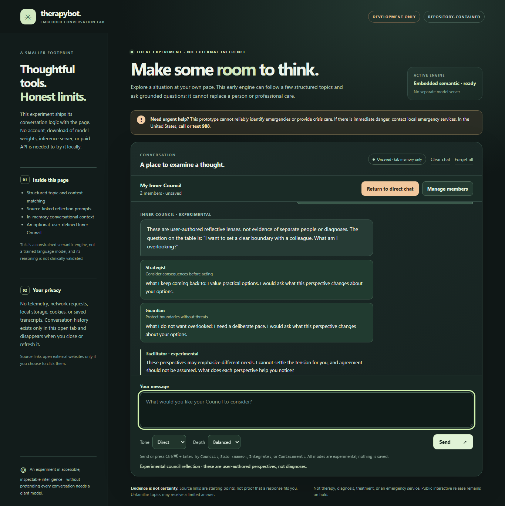
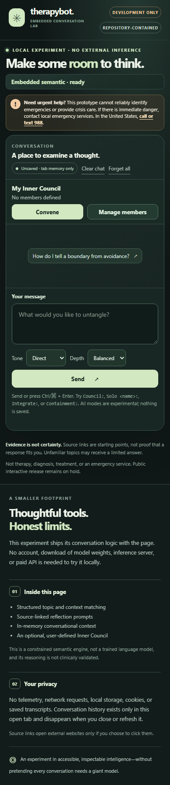

# TherapyBot live browser UX verification — 2026-11-04

**Evidence type:** real browser interaction and screenshot review, **not** clinical validation, assistive-technology certification, independent inference, or public-release approval.

## Frozen context

- Draft PR: [#11](https://github.com/thebrazenbeard/therapybot/pull/11), isolated `embedded/` experiment.
- Tested repository commit: `f1f5bd584ee46b999c5398adb8fc1d994b3085ea`.
- Host: owner-authorized Windows Lappy through Executor Lappy Dedicated.
- Browser: installed Microsoft Edge 156 (isolated headless profile, no interaction with the owner's active Firefox windows).
- Driver: `node tests/browser_smoke.cjs` using the host's existing Puppeteer-core installation.
- Server: temporary random port bound to `127.0.0.1`; no public host or cloud inference.
- Data: synthetic conversation and two invented user-authored perspectives (`Strategist` and `Guardian`); no owner trauma record or conversation export used.

## Actual result

13 of 13 browser smoke interactions passed on a second run after UX edits:

1. Fresh session contains no Council members or phantom conversation.
2. Convene with empty roster prompts the user to author perspectives.
3. Two members are created locally.
4. Two turns render individual perspective cards and facilitator text.
5. `Solo Strategist:` selects one configured perspective.
6. A known explicit imminent-danger phrase vetoes simulated Council output.
7. `Containment:` deactivates the persistent Convene toggle.
8. Ordinary chat remains possible afterward.
9. Clear chat retains the visibly unsaved Council roster.
10. User-provided HTML remains text, not an executable image node.
11. Forget all requires confirmation and clears both conversation and roster.
12. A 390px-wide mobile layout has no horizontal overflow.
13. No external page network requests, JavaScript exceptions, or console errors were recorded.

The reproducible smoke script generates a structured JSON transcript and screenshots in an isolated artifact directory; it removes only its temporary browser profile. The browser loopback listener is closed after the run.

## Screenshots from actual Edge render

The first screenshot reveals the experience after the roster editor was made collapsible upon Convene; the second reflects the compact mobile introduction after a manual visual critique.

## Hostile UX verdict

> The shell is usable, but the conversation engine does not yet respond with the flexibility or understanding implied by a fully resident conversational entity. Its Council responses are deterministic, limited reflections of user-authored roles rather than genuinely reasoned internal debate. Good layout and 13 green browser checks cannot repair that limitation.

> Independently authored safety checks found serious missed danger routes and a caller-supplied safety bypass in an earlier snapshot. Specific regressions were added afterward, but lexical heuristics remain unvalidated and easy to evade with new language. No public interactive release, psychotherapy claim, model-safety qualification, or clinical approval follows from this test.

## Next qualification gates

- Select one canonical engine after resolving competing draft PR #12; avoid shipping two different conversation semantics.
- Demonstrate actual local browser-native neural GGUF inference, including model rights, reproducible asset integrity, offline mode, and performance on representative hardware, if it materially improves conversation quality.
- Run independently reserved, broader adverse-dialogue evaluations, generated-output checks, and qualified human clinical/privacy review.
- Test Edge, Firefox, keyboard navigation, screen readers, different viewport heights, and long-message resilience with actual users before any public interactive release.
