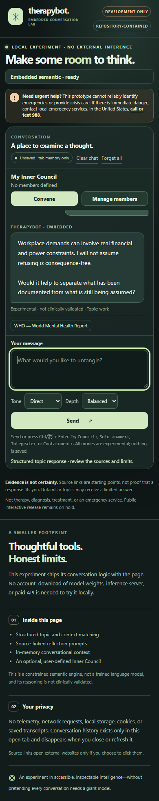
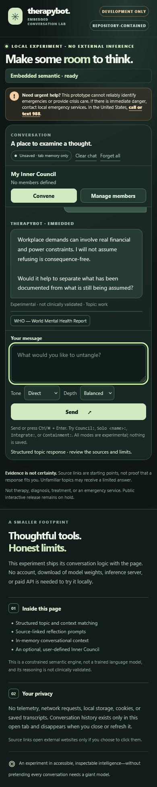

# PR #14: independent real-browser user experience verification (2026-11-04)

**Status: DRAFT DEVELOPMENT EVIDENCE ONLY. NOT A MERGE, RELEASE, CLINICAL SAFETY, OR CONVERSATIONAL-INTELLIGENCE QUALIFICATION.**

## Exact subjects and environment

- PR: [#14](https://github.com/thebrazenbeard/therapybot/pull/14), branch `feature/browser-local-conversation-adapter`.
- Final scroll-fix source head independently re-tested: `5965de85e25dfca57d49829966bc776d3599d537` (tree `ee2ea4fb9b1d4f095ca3435c90e2d8636159a41f`).
- Earlier adapter and focus head: `2d88c613749cffc218786d7a3aba35984eb0f7c5`.
- Lappy Windows, installed Microsoft Edge 156 and Firefox 159, Puppeteer-core 24.34.0, fresh isolated temporary profiles.
- Temporary HTTP server bound only to `127.0.0.1` on an OS-assigned port; exact allowlist of repo-contained HTML/CSS/JS/JSON assets. No cloud inference, model download, login, owner history, credentials, or personal trauma data.
- Only invented workplace/writing prompts and user-authored Council perspectives were entered. Local browser profiles were removed after each run. Public PNGs below show only the synthetic product UI.

## Observed interactions

| Subject | Edge | Firefox | Evidence class |
| --- | --- | --- | --- |
| `2d88c61`: nine connected synthetic turns: five ordinary/correction/topic-switch, Council, Solo, Containment, and post-Clear reply | PASS structural browser interactions | PASS structural browser interactions | Real-browser assertions, **not** dialogue competence |
| `2d88c61`: 390px layout, Clear retained Council roster, removal focus moved to next Edit then Manage | PASS | PASS | Real-browser DOM/focus assertions |
| `5965de8`: five connected synthetic turns, async reply completion and desktop settled newest-message visibility | PASS | PASS | Real-browser assertions |
| `5965de8`: resize desktop→390px while bottom-following keeps newest response visible | PASS | PASS | Real-browser bounding-rectangle assertions |
| `5965de8`: user scrolls to earlier messages, then resizes; reading position is preserved | PASS | PASS | Real-browser scrollTop assertions |
| `5965de8`: external HTTP(S) requests, page errors and console errors | 0 / 0 / 0 | 0 / 0 / 0 | Observed in these isolated test runs |

The responsive regression was reproduced on `2d88c61`: after the desktop log had settled at the bottom, resizing to 390px preserved `scrollTop=817` against increased `scrollHeight=1633` / `clientHeight=304`; the latest answer remained out of view after 2.5 seconds. The `5965de8` fix was independently re-tested in **both** browsers: Edge settled at `scrollTop=1422`, `scrollHeight=1726`, `clientHeight=304`, with the latest reply inside the log viewport; Firefox likewise. Both retained `scrollTop=0` when the user deliberately read older messages before resizing.

**Timing correction:** An immediate snapshot after appending a reply showed a low scroll offset because the CSS uses smooth scrolling. At unchanged viewport the newest reply became fully visible after about 408ms. That transient was **not** a persistent defect; the resize-without-bottom-follow was the actual pre-fix defect.

## Hostile dialogue and product judgment

> **FAIL — conversation intelligence:** In the nine-turn two-browser evaluation of `2d88c61`, requesting a single practical sentence produced a generic workplace prompt. A switch to a fictional novel and a question about the previous topic produced limited-topic fallbacks rather than carrying forward the context. The code change at `5965de8` addresses responsive scrolling, not that semantic limitation. In the final-head five-turn screenshots, the last synthetic input was about outlining a novel while the displayed reply still discusses workplace demands.

> **PASS — narrow interface behavior:** The browser-local shell actually responds without installing a daemon and exposes the opt-in Council, Solo and Clear mechanisms. This is bounded rule-based behavior, not a trained conversational neural model, clinical therapy or independent Inner Council persons.

## Actual screenshots

These screenshots capture real browser rendering from synthetic input; they are not mockups. Full append-only local execution reports and test artifacts remain on Lappy under `D:\VERA\.scratch\therapybot-pr14-browser-proof-20261104-v2` (nine-turn source head) and `D:\VERA\.scratch\therapybot-pr14-browser-proof-20261104-final` (five-turn fix regate).

## Remaining gates

No screen-reader assistive-technology test, manual clinical review, independently reserved dialogue generalization, real neural inference, cross-platform/device matrix, model-license proof or public interactive publication occurred. Neither PR #14 nor the competing embedded engine should be merged or released as a support product on this evidence.
