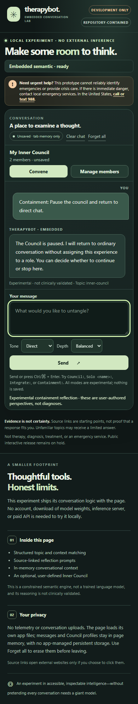
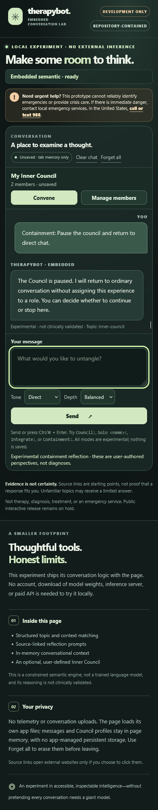

# PR #18: independent Edge/Firefox loopback browser qualification (2026-11-04)

**DRAFT EVIDENCE ONLY. NOT A MERGE, DEPLOYMENT, CLINICAL-SAFETY REVIEW, MODEL-INFERENCE QUALIFICATION, OR PUBLIC RELEASE AUTHORIZATION.**

## Pinned subject and method

- Tested repository: `thebrazenbeard/therapybot`, draft [PR #18](https://github.com/thebrazenbeard/therapybot/pull/18), branch `integration/canonical-source-pinned-20261104`.
- **Exact source commit under test:** `357eb95407efb2e331afde82bc09ff1712e41fef` (tree `fc9afad857dcbf2a20ce0c531b7feeb745ef8271`). This evidence commit only adds this report and synthetic screenshots; tests were run against the earlier pinned source commit.
- Host: authorized Lappy, isolated detached checkout `D:\VERA\.scratch\therapybot-pr18-realbrowser-20261104`, fresh disposable headless browser profiles, never the owner's browser profile.
- Actual engines: Microsoft Edge `Edg/156.0.4314.58` and Firefox `firefox/159.0`; Puppeteer-core from existing local installation. No model weights, services, user credentials, accounts, host restarts, public publication or cloud inference.
- Real HTTP: ephemeral `127.0.0.1` server with exact bundled asset allowlist (`index.html`, `style.css`, `catalog.js`, `engine.js`, `council.js`, `conversation_adapter.js`, `ui.js`); method `GET` only; `favicon.ico` 204. Test server enforced a restrictive CSP (`default-src 'none'; script-src 'self'; style-src 'self'; font-src 'self' data:; img-src 'self' data:; connect-src 'none'; form-action 'none'; base-uri 'none'; object-src 'none'; frame-ancestors 'none'`). This does **not** prove the same policy is deployed elsewhere.
- Scripted input was generic synthetic text only (workplace boundary, fictional archivist and letter). Council member labels were synthesized as Strategist and Guardian. No user's history, trauma record, browser profile or personal data were accessed.

## Observed verification

| Check | Edge 156 | Firefox 159 |
| --- | --- | --- |
| In-repo `tests/browser_smoke.cjs` | **15/15 PASS** (Edge) | Not run as a separate shipped smoke suite |
| Independent connected dialogue | **9/9 turns rendered** | **9/9 turns rendered** |
| Post-Clear Ctrl+Enter | PASS (10th turn) | PASS (10th turn) |
| Actual adapter and five bundled JS assets under HTTP/CSP | PASS | PASS |
| Two user-authored Council lenses / Solo / Integrate / Containment | PASS | PASS |
| Generated speakers are Perspective 1/2; user labels remain distinct | PASS | PASS |
| Council output does not merely echo supplied role description | PASS | PASS |
| Clear retains members; Forget erases; Edit focus after removal | PASS | PASS |
| 390px viewport horizontal overflow | 0px | 0px |
| Desktop-to-mobile latest reply visible after resize | PASS (last bottom 457px, panel bottom 467px) | PASS (466px vs 476px) |
| User intentionally scrolled up before reverse resize | PASS (scrollTop 0) | PASS (scrollTop 0) |
| Unexpected HTTP(S) destinations / HTTP 404 / page JS errors / console errors | **0 / 0 / 0 / 0** | **0 / 0 / 0 / 0** |

The test also observed the script-disabled native forms are inert in the shipped Edge smoke; no dialogue text was sent by GET/POST. The active page made no external HTTP(S) request. Firefox's in-page `data:` font resource is bundled data, **not an external network request**. Keyboard and focus checks are a **targeted accessibility smoke**, not a WCAG conformance audit.

### Visual proof

All screenshots were captured from isolated test pages with **synthetic dialogue only**; there is no browser chrome, personal profile, private data or user-identifying metadata in their visible content.

- 
- 

## Material hostile finding: dialogue semantics still fail

Structural routing and browser behavior passing do **not** imply a capable assistant. In the actual ten-turn run:

1. After an explicit correction that the work request was *recurring*, asking for **one practical sentence** produced the same broad topic-menu fallback instead of a sentence.
2. Switching to a **fictional archivist discovering a sealed letter** also produced that generic fallback.
3. Asking what was discussed **before** that topic switch again returned the generic fallback, with no usable recall of the boundary question.

These are concrete live-browser dialogue-quality failures. The engine's subject-domain limits may be honest, but the interface invites natural conversation it cannot reliably sustain; it is not a qualified general conversational agent.

## Confidence and remaining holds

- **Verified:** HTML/JS integration, local routing, client-side interaction, selected focus/keyboard semantics, responsive scroll, and no observed external egress under this isolated server's strict CSP.
- **Not verified:** broad accessibility, privacy beyond the observed session/network, safety routing for unseen cases, crisis handling, clinical effectiveness, or neural language-model ability. Browser execution remains a local prototype, not a production deployment.
- **Decision:** retain draft/release hold. Do not merge or deploy interactive public Pages on this evidence alone.

Evidence session: `therapybot.pr18.browserux.20261104`; Lappy Blotter entry **#4414**.